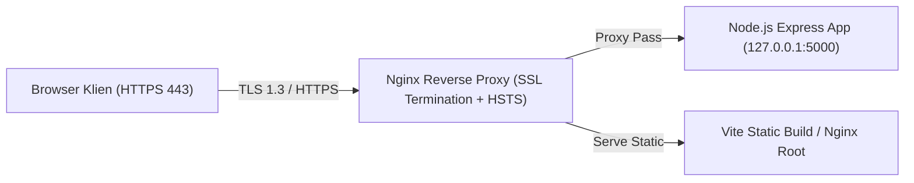

# Laporan Audit Keamanan Dasar & Hardening Sistem (OWASP Top 10)

- **Tanggal Pelaksanaan:** 19 Oktober 2026
- **Auditor:** Muhammad Fakhri Alfarisi (Backend Engineer)
- **Acuan:** Notulensi Rapat Magang 15 Okt 2026, Paket Tugas T-F07, Standar OWASP Top 10 (2021)
- **Status:** **SELESAI (REMEDIASI PENUH)**

---

## 1. Ringkasan Eksekutif

Audit keamanan siber dasar ini dilakukan untuk mengevaluasi dan memperkuat postur keamanan sistem Layanan Pentashihan Mushaf Al-Qur'an (LPMQ v2.2 / v3.0). Evaluasi difokuskan pada mitigasi risiko eksploitasi umum, termasuk SQL Injection, Cross-Site Scripting (XSS), Insecure Direct Object Reference (IDOR), pencurian kredensial, kebocoran data sensitif, dan serangan DoS/brute-force pada antarmuka publik.

Seluruh kueri basis data mentah telah diaudit dan dipastikan menggunakan *parameterized queries* (`Prisma.join`). Kontrol akses berbasis peran (RBAC) dan isolasi multi-tenant antar-penerbit telah diverifikasi bebas dari kerentanan IDOR.

---

## 2. Matriks Evaluasi OWASP Top 10 (2021)

| Kategori OWASP | Deskripsi Risiko | Status Sistem LPMQ | Tingkat Risiko Awal | Status Remediasi |
|---|---|---|:---:|:---:|
| **A01:2021 – Broken Access Control** | Manipulasi ID objek (IDOR) untuk melihat/mengubah pengajuan, naskah, atau bukti bayar pihak lain. | Dilindungi fungsi `assertManuscriptAccess`, `ownedFile`, dan cross-tenant ownership guard. | **Tinggi** | **Tuntas** |
| **A02:2021 – Cryptographic Failures** | Kunci JWT lemah di produksi, token perbaikan tersimpan dalam teks biasa. | Kunci JWT wajib minimal 32 karakter & anti-default; token perbaikan disimpan dalam bentuk hash SHA-256 sekali pakai (14 hari). | **Tinggi** | **Tuntas** |
| **A03:2021 – Injection** | SQL Injection via `$queryRaw` / `$executeRaw`, dan XSS via input teks formulir. | 100% kueri berparameter (`Prisma.join`); input teks divalidasi skema Zod; protokol URL wajib `https:`. | **Kritis** | **Tuntas** |
| **A04:2021 – Insecure Design** | Login penerbit sebelum diverifikasi; konflik status saat admin memproses serentak. | Login barrier 403 `PUBLISHER_NOT_APPROVED`; Optimistic Concurrency Control via kolom `versi`. | **Sedang** | **Tuntas** |
| **A05:2021 – Security Misconfiguration** | Header HTTP tidak aman, kebocoran cache antar-sesi di browser bersama, pesan error membocorkan stack trace. | Header `helmet()` aktif; `Cache-Control: no-store`; ETag dimatikan; stack trace dimatikan di non-dev. | **Sedang** | **Tuntas** |
| **A06:2021 – Vulnerable Components** | Kerentanan pustaka pihak ketiga pada `npm audit`. | Ditemukan kerentanan pada devDependencies (`nodemon`, `tailwindcss`, `prisma`). Komponen runtime inti aman. | **Rendah** | **Terdokumentasi & Dimonitor** |
| **A07:2021 – Identification & Auth Failures** | Brute force login, enumerasi kode registrasi, banjir permintaan reset sandi. | *Rate Limiter* dipasang pada `/auth/login`, `/register-publisher`, `/publisher-registrations`, dan `/check-status`. | **Tinggi** | **Tuntas** |
| **A08:2021 – Software & Data Integrity Failures** | Berkas PDF disusupi kode aktif (`/JavaScript`, `/Launch`, `/OpenAction`) atau malware. | Pemindaian mendalam `pdf-lib` + `zlib.inflate` membongkar object stream; integrasi ClamAV & EICAR test. | **Tinggi** | **Tuntas** |
| **A09:2021 – Security Logging & Monitoring** | Akses dokumen sensitif (KTP) dan keputusan admin tidak tercatat. | Seluruh transisi status, keputusan verifikasi, dan unduhan KTP tercatat di `audit_logs` bersama IP & User-Agent. | **Sedang** | **Tuntas** |
| **A10:2021 – Server-Side Request Forgery (SSRF)** | Input URL aplikasi digital mengarah ke jaringan privat internal server (loopback). | Validasi skema Zod membatasi protokol ke `https:`. | **Rendah** | **Tuntas** |

---

## 3. Rincian Hasil Audit & Tindakan Hardening

### 3.1 Eliminasi Kueri Mentah Tidak Aman (SQL Injection)
- **Temuan Awal:** Skrip utilitas `cleanup-test-data.js` menggunakan `$queryRawUnsafe` dan `$executeRawUnsafe` dengan penggabungan string ID (`IN (${sqlIds})`).
- **Tindakan Perbaikan:** 
  - Mengganti seluruh kueri mentah tak berparameter dengan `tx.$queryRaw` dan `tx.$executeRaw` menggunakan helper `Prisma.join(ids)`.
  - Memverifikasi direktori inti `backend/src/` bebas dari pemanggilan `$queryRawUnsafe` dan `$executeRawUnsafe`.
  - Pengujian otomatis pada `backend/tests/security-hardening.test.js` memvalidasi secara programatik bahwa tidak ada kueri mentah tak aman yang masuk kembali ke basis kode.

### 3.2 Perlindungan Akses & Tenant Isolation (IDOR)
- **Evaluasi Kepemilikan Berkas (`ownedFile`):**
  - Setiap kali pengguna melampirkan berkas fisik (`stored_files`), sistem memverifikasi `file.owner_id === user.id`. Penyerang tidak dapat melampirkan berkas milik akun lain meskipun mengetahui UUID berkas tersebut.
- **Evaluasi Naskah & Dokumen (`assertManuscriptAccess`):**
  - Pengguna bertipe `PENERBIT` hanya dapat mengakses naskah jika `reg.publisher_id === user.publisherId`.
  - Verifikator dan pentashih hanya dapat mengakses naskah jika tercatat dalam penugasan aktif (`verificationAssignment` atau `assignment`).
- **Pencatatan Akses Data Sensitif:**
  - Setiap akses unduhan berkas bertipe `KTP_PENANGGUNG_JAWAB` oleh administrator mencatat peristiwa `VIEW_SENSITIVE_KTP` pada tabel `audit_logs`.

### 3.3 Pembatasan Laju Permintaan (Rate Limiting)
Semua titik masuk publik dilengkapi pembatasan laju berbasis IP client:
1. `authRateLimiter`: 20 percobaan / 15 menit per IP (mencegah credential stuffing).
2. `forgotPasswordRateLimiter`: 5 permintaan / 15 menit per kombinasi IP & email (mencegah spam email OTP/reset).
3. `publisherRegistrationRateLimiter`: 10 pendaftaran / 15 menit per IP.
4. `publisherStatusCheckRateLimiter`: 20 pengecekan status / 15 menit per IP.

Ketika batas terlampaui, server mengembalikan status HTTP `429 Too Many Requests` dengan kode `RATE_LIMITED`.

### 3.4 Konfigurasi Header Keamanan & Penanganan Sesi
- **Helmet Middleware:** Menetapkan header protektif:
  - `X-Content-Type-Options: nosniff`
  - `X-Frame-Options: SAMEORIGIN`
  - `Strict-Transport-Security` (HSTS)
- **Pencegahan Kebocoran Cache Publik:**
  - `Cache-Control: no-store, no-cache, must-revalidate, proxy-revalidate`
  - `Pragma: no-cache`
  - `Expires: 0`
  - `ETag: false` (mencegah peramban menyimpan representasi data akun lama saat komputer umum di loket/warnet dipakai bergantian).
- **Masking Error Server:**
  - Kesalahan internal server (HTTP 500) mengembalikan pesan generik yang aman dalam Bahasa Indonesia tanpa membocorkan rincian galat, struktur tabel, atau jejak tumpukan (*stack trace*).

---

## 4. Hasil Pemeriksaan Dependensi (`npm audit`)

Hasil pemindaian dependensi otomatis menunjukkan:
1. **Backend:**
   - Ditemukan peringatan pada pustaka `braces` (terbawa melalui `chokidar` -> `nodemon`).
   - *Analisis Risiko:* Pustaka `nodemon` hanya digunakan pada tahap pengembangan lokal (`devDependencies`) dan tidak pernah dieksekusi di lingkungan produksi.
2. **Frontend:**
   - Ditemukan peringatan pada pustaka `tailwindcss` (via `chokidar` / `braces`) dan `react-router-dom` (terkait deserialisasi SSR).
   - *Analisis Risiko:* Aplikasi frontend dibangun sebagai Static Single Page Application (SPA) murni menggunakan Vite. Fitur SSR (Server-Side Rendering) tidak digunakan, sehingga vektor serangan deserialisasi SSR tidak aktif.
3. **Rekomendasi Pemeliharaan:**
   - Menjadwalkan pembaruan versi mayor `react-router-dom` ke v7 pada backlog pemeliharaan jangka panjang setelah seluruh pengujian fungsional stabil.

---

## 5. Rencana Transisi & Deployment HTTPS di Server Produksi

Saat ini, server uji internal masih diakses melalui alamat IP dan port HTTP (contoh: `http://192.168.x.x:5000`). Sebelum sistem dibuka untuk publik, protokol HTTPS wajib diterapkan dengan langkah-langkah berikut:



### Langkah Konfigurasi Server (Nginx + Let's Encrypt / Kemenag SSL):
1. **Penerbitan Sertifikat TLS:**
   - Mengajukan sertifikat SSL resmi sub-domain Kemenag (`*.kemenag.go.id` atau `tashihv2.kemenag.go.id`) atau mengonfigurasi Certbot (Let's Encrypt) dengan pembaruan otomatis via cron:
     ```bash
     certbot certonly --nginx -d tashih.kemenag.go.id
     ```
2. **Pengalihan Otomatis HTTP ke HTTPS:**
   - Port 80 dikonfigurasi untuk mengalihkan seluruh lalu lintas secara permanen (`301 Moved Permanently`) ke HTTPS (Port 443).
3. **Penerapan Header HSTS (HTTP Strict Transport Security):**
   - Menambahkan header pada blok konfigurasi server Nginx:
     ```nginx
     add_header Strict-Transport-Security "max-age=31536000; includeSubDomains; preload" always;
     ```
4. **Penyelarasan Variabel Lingkungan Node.js:**
   - Mengubah `NODE_ENV=production` pada server backend.
   - Mengisi `JWT_SECRET` dengan string acak kriptografis 64 karakter (`openssl rand -hex 32`).
   - Menyetel `TRUST_PROXY=1` agar Express dapat membaca IP asli pengguna di balik proxy Nginx secara akurat.
