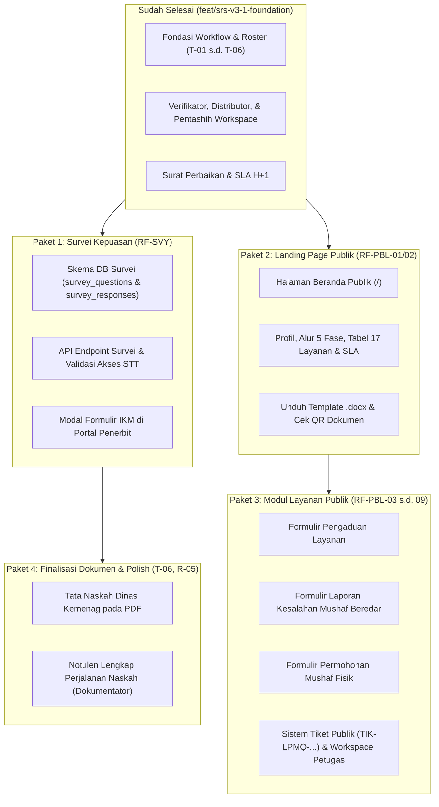

# Peta Jalan & Sisa Pekerjaan Sistem LPMQ (SRS v3.0 & v3.1)

Dokumen ini memetakan status menyeluruh implementasi Sistem Manajemen Layanan Pentashihan Mushaf Al-Qur'an (LPMQ) Kementerian Agama RI pasca-penyelarasan rapat 8 Oktober 2026 (T-01 s.d. T-06).

---

## I. Rekapitulasi Fitur yang Telah Selesai (100% Lulus Uji)

| No | Modul / Fitur | Acuan Regulasi / SRS | Status Kode & Pengujian |
|---|---|---|---|
| 1 | **Roster Pentashih SK 2025 & Multi-Role** | SK LPMQ 2025 (T-01) | Selesai (`seed.js`, 90 personil, 6 kelompok utama, integrasi peran ganda) |
| 2 | **Intake Fisik & Akun Admin Internal** | T-03 (Opsi A), RF-REG-11, RF-REG-13 | Selesai (M. Zamroni Ahbab & Mustakim sebagai `ADMIN_INTERNAL`, verifikasi resi & tanda terima fisik) |
| 3 | **Ceklis Verifikator Resmi & Arsip Sidebar** | T-06, RF-VER-01, RF-VER-04, BR-32 | Selesai (Ceklis Berita Acara resmi, tombol "Ajukan Draft", arsip dokumen dipindah ke sidebar) |
| 4 | **Penugasan Rentang Juz & Evaluasi Pentashih** | T-01, RF-DIST-05, RF-DIST-18, RF-DIST-19 | Selesai (Rentang juz non-overlap, unggah berkas rekapan rahasia internal `recap_file_id`) |
| 5 | **Surat Pengembalian Revisi & Penetapan Dumi** | T-04, T-06, RF-DIST-08, RF-DIST-17 | Selesai (Pilihan `NASKAH_PERBAIKAN` vs `NASKAH_DUMI`, penomoran ronde otomatis 1, 2, 3, penerbitan `REVISION_RETURN_LETTER`) |
| 6 | **Perhitungan SLA H+1 & Template Dokumen** | T-02, T-05, RF-CALC-05, RF-PUB-08, RF-PBL-01 | Selesai (SLA H+1 pasca bayar sah, unduhan `template-surat-permohonan-tashih.docx`, label pengiriman beresolusi tinggi) |
| 7 | **Pengujian Otomatis CI/CD** | RNF-REL-01 s.d. 04 | **Backend**: 21 migrasi, 63 unit tests, 101 integration tests lulus (100%). **Frontend**: 43 test suites, 201 tests lulus (100%). |

---

## II. Daftar Sisa Pekerjaan yang Belum Dikerjakan

Berdasarkan dokumen SRS v3.0, draf SRS v3.1, dan Rencana Implementasi, berikut adalah 4 (empat) paket pekerjaan utama yang tersisa untuk diselesaikan:

---

### Paket 1: Survei Indeks Kepuasan Masyarakat (IKM) pada Akses STT (`RF-SVY-01` s.d. `RF-SVY-08`)
**Urgensi**: Kritis / Prasyarat Penerbitan STT Resmi (Sesuai PermenPAN-RB).

1. **Model Data & Migrasi Database**:
   - Tabel `survey_questions`: ID, teks pertanyaan (skala Likert 1–5), kategori, urutan, status aktif.
   - Tabel `survey_responses`: ID, `registration_id`, `publisher_id`, nilai/skor per butir pertanyaan (JSON), kritik & saran, timestamp pengisian.
2. **Backend API**:
   - `GET /api/v1/surveys/active`: Menyajikan daftar instrumen pertanyaan survei aktif.
   - `POST /api/v1/surveys/submissions`: Merekam hasil evaluasi kepuasan penerbit dan menandai hak akses STT terbuka.
   - `GET /api/v1/registrations/:id/stt-status`: Mengecek kelayakan unduh STT (apakah survei telah diisi atau terdapat override persetujuan admin).
   - Validasi pada `GET /api/v1/registrations/:id/stt-pdf`: Memblokir pengunduhan dokumen STT final apabila survei kepuasan belum diisi.
3. **Frontend Portal Penerbit**:
   - Dialog interaktif `SatisfactionSurveyModal.jsx` yang otomatis muncul saat penerbit mengklik tombol "Unduh Surat Tanda Tashih".
   - Formulir bintang/skala 1–5 dengan masukan teks apresiasi/saran perbaikan.
   - Notifikasi sukses dan pembukaan instan link unduh dokumen resmi STT.
   - Fail-safe override untuk Admin/Dokumentator jika terjadi kendala teknis darurat.

---

### Paket 2: Landing Page Publik LPMQ (`RF-PBL-01` & `RF-PBL-02`)
**Urgensi**: Wajah Publik Sistem & Aksesibilitas Informasi Masyarakat.

1. **Rute Beranda Publik**:
   - Mengubah rute root `/` pada `router.jsx` agar menampilkan `LandingPage.jsx` responsif tanpa mewajibkan login akun.
   - Pengguna terautentikasi tetap memiliki opsi pintasan cepat "Masuk ke Dashboard".
2. **Komponen Konten Landing Page**:
   - **Hero Section**: Visi dan layanan resmi Lajnah Pentashihan Mushaf Al-Qur'an Balitbang Diklat Kemenag RI.
   - **Alur Interaktif**: 5 fase tahapan pentashihan mushaf Al-Qur'an dari pengajuan berkas hingga penerbitan STT.
   - **Katalog Layanan & Tarif PNBP**: Tabel interaktif 17 jenis mushaf beserta standar durasi waktu (SLA) dan tarif resmi.
   - **Unduhan Berkas Persyaratan**: Tombol unduh resmi `template-surat-permohonan-tashih.docx` dan pedoman penulisan rasm usmani.
   - **Pintasan Akses Cepat**:
     - Tombol "Daftar / Masuk Portal Penerbit".
     - Tombol "Verifikasi Keaslian Dokumen & QR STT".
     - Tombol "Layanan Pengaduan & Aspirasi Masyarakat".
   - **FAQ & Informasi Kontak**: Alamat Gedung Bayt Al-Qur'an & Museum Istiqlal TMII, kontak WhatsApp, email, dan jam kerja operasional loket.

---

### Paket 3: Modul Layanan Publik & Pengaduan Masyarakat (`RF-PBL-03` s.d. `RF-PBL-09`)
**Urgensi**: Saluran Pelayanan Publik & Pengawasan Peredaran Mushaf.

1. **Tiga Formulir Layanan Publik (Tanpa Perlu Login)**:
   - **Pengaduan Layanan** (`RF-PBL-03`): Pelaporan ketidaksesuaian SOP/pelayanan petugas.
   - **Laporan Kesalahan Penulisan Mushaf** (`RF-PBL-04`): Pelaporan mushaf beredar yang diduga salah cetak/tanda baca (memuat judul mushaf, penerbit, tahun, surah/ayat, foto bukti).
   - **Permohonan Mushaf Al-Qur'an Fisik** (`RF-PBL-05`): Permohonan mushaf cetak LPMQ untuk masjid/pesantren/lembaga sosial.
2. **Sistem Tiket & Tracking**:
   - Pembuatan nomor tiket otomatis: `TIK-LPMQ-YYYYMM-XXXX`.
   - Halaman publik pelacakan progres tiket masyarakat (`/tracking/:ticketNumber`).
3. **Modul Kerja Petugas Layanan Publik (`PETUGAS_LAYANAN_PUBLIK`)**:
   - Workspace penanganan tiket pengaduan di portal internal.
   - Pencatatan disposisi dan kronologi tindak lanjut internal (append-only audit).
   - Penutupan tiket dengan kesimpulan resmi.
4. **Proteksi Keamanan**:
   - Rate limiting IP, validasi ukuran berkas lampiran (maks 5MB), isolasi database dari entitas `Registration` agar tidak mengganggu transaksi perizinan STT.

---

### Paket 4: Tata Naskah Dinas Kemenag & Ekspor Notulen Perjalanan Naskah (T-06, R-05)
**Urgensi**: Kepatuhan Administratif Naskah Dinas Kementerian Agama RI.

1. **Penyeragaman Redaksi Berita Acara & Surat**:
   - Penyesuaian format nomor dinas standar Kemenag: `B-[Nomor]/LPMQ.01/TL.00/[Bulan]/[Tahun]`.
   - Diksi resmi: Menggantikan istilah teknis sistem dengan tata bahasa dinas Kementerian Agama (misal: "Hasil Telaah Pentashihan", "Pengembalian Naskah untuk Disempurnakan").
2. **Notulen Perjalanan Naskah untuk Dokumentator**:
   - Halaman ringkasan riwayat naskah komprehensif bagi petugas Dokumentator: memuat kronologi tanggal masuk, tanda terima fisik, catatan ronde revisi 1 s.d. n, surat pengembalian, hingga penerbitan STT.

---

## III. Matriks Perbandingan & Rekomendasi Urutan Eksekusi

| Prioritas | Paket Pekerjaan | Perkiraan Bobot | Ketergantungan | Alasan Rekomendasi |
|---|---|---|---|---|
| **Langkah 1 (Disarankan)** | **Paket 1: Survei Kepuasan (RF-SVY)** | Sedang | Membutuhkan status `READY_FOR_STT` / `STT_ISSUED` (Sudah siap) | Merupakan penutup siklus pengajuan penerbit sebelum mengunduh STT. Alur inti operasional menjadi 100% tuntas dari pendaftaran s.d. download STT. |
| **Langkah 2** | **Paket 2: Landing Page Publik (RF-PBL-01/02)** | Ringan-Sedang | Mandiri (Frontend & Master Data) | Menyediakan pintu depan resmi bagi publik dan memudahkan penerbit baru mengunduh template surat & memahami alur. |
| **Langkah 3** | **Paket 3: Modul Layanan Publik (RF-PBL-03 s.d. 09)** | Sedang-Besar | Bergantung pada Landing Page | Melengkapi fitur kanal masyarakat & laporan mushaf beredar sesuai mandat regulasi LPMQ. |
| **Langkah 4** | **Paket 4: Tata Naskah Dinas & Ekspor Notulen** | Ringan | Paket 1 selesai | Memastikan seluruh dokumen PDF siap cetak dengan tipografi dinas resmi Kemenag. |

