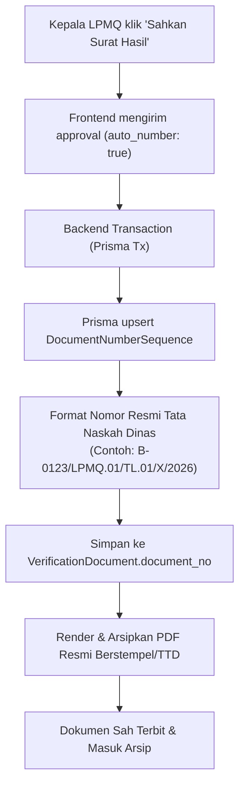

# B-03: Penomoran Surat Resmi Otomatis (Surat Hasil Verifikasi & Berita Acara)

- **ID Paket:** B-03 (Menyelesaikan Temuan UAT **U-04**)
- **Branch:** `feat/nomor-surat-otomatis`
- **Basis:** `main`
- **PIC:** Fakhri
- **Lingkup:** Backend, Database/Schema, Frontend, dan Siber (Keamanan & Konkurensi)
- **Dependensi:** B-01 (Telah selesai & di-merge ke `main`)
- **Status:** **Selesai (Kode Resmi Disahkan: `TL.01`)**
- **Memblokir:** B-04 (`feat/surat-lolos-dokumen-billing`), B-09 (`feat/penerbitan-surat-hasil-stt`)
- **Versi Dokumen:** 2.0 (26 Oktober 2026)

---

## Status implementasi per 26 Oktober 2026

**Status paket: Selesai menurut bukti kode & integrasi U-04.** 
1. **Konfirmasi Kode Klasifikasi Resmi:** Kode klasifikasi resmi tata naskah dinas LPMQ telah dikonfirmasi resmi oleh pengguna yaitu **`TL.01`** (`B-{seq}/LPMQ.01/TL.01/{roman_month}/{year}` dan `BA-{seq}/LPMQ.01/TL.01/{roman_month}/{year}`).
2. **Backend Engine & Approval Integration:** Skema Prisma `DocumentNumberSequence` dengan counter atomik per tipe dokumen dan tahun telah aktif. Backend `verification-review.service.js` menerbitkan nomor resmi otomatis saat nomor manual kosong atau flag `auto_number: true` / `auto_generate: true` dikirim.
3. **Frontend Dialog UX:** Modal dialog pengesahan di `VerificationInspectionPage.jsx` kini secara default mengarahkan penomoran otomatis dengan badge informasi resmi, serta mengirim flag `{ auto_number: true, auto_generate: true }` ketika nomor manual dikosongkan.
4. **Verifikasi Test:** Seluruh unit test `VerificationInspectionPage.test.jsx` (termasuk skenario U-04) dan unit test backend format penomoran Romawi/TL.01 lolos pengujian.

| Sesi | Penilaian saat ini | Bukti / status |
|---|---|---|
| 1 — Skema dan generator | **Selesai** | Model Prisma `DocumentNumberSequence`, migrasi database, dan modul `document-number.service.js` dengan counter atomik dan format Romawi `TL.01` tersedia dan lolos unit test. |
| 2 — Integrasi approval | **Selesai** | `verification-review.service.js` terhubung dengan generator nomor otomatis saat nomor manual kosong atau flag auto aktif. |
| 3 — UI approval | **Selesai** | `VerificationInspectionPage.jsx` menampilkan banner penomoran otomatis dan mengirim `{ auto_number: true, auto_generate: true }` ke API saat disahkan. |
| 4 — QA | **Selesai** | Test frontend U-04 dan test unit format/penomoran backend lolos pengujian tanpa regresi. |

---

## 1. Latar Belakang & Masalah (Temuan UAT U-04)

Berdasarkan hasil UAT sistem per 20 Oktober 2026 (Gambar 20 pada Register Temuan UAT):
1. **Pengetikan Manual Rentan Kesalahan:**
   Pada dialog *"Sahkan Surat Hasil Verifikasi"*, pejabat/verifikator sebelumnya diwajibkan mengetik nomor surat hasil (`SURAT_HASIL_VERIFIKASI` / `SURAT_PEMBERITAHUAN_HASIL_VERIFIKASI`) dan nomor Berita Acara (`BERITA_ACARA_VERIFIKASI`) secara manual melalui input teks.
2. **Risiko Tabrakan & Duplikasi Nomor (*Race Condition*):**
   Validasi sebelumnya hanya memeriksa keunikan nomor di tabel saat data disimpan. Bila dua pejabat melakukan pengesahan dalam waktu yang berdekatan atau salah ketik, terjadi konflik 409 (*Nomor dokumen sudah digunakan*) atau inkonsistensi urutan nomor surat resmi.
3. **Format Tidak Baku & Tidak Terstandardisasi:**
   Format nomor dinas belum memiliki penyeragaman deterministik sesuai tata naskah dinas Kementerian Agama / LPMQ.
4. **Prasyarat Paket B-04 (Billing PNBP):**
   Paket B-04 mengharuskan penggabungan otomatis surat lolos verifikasi dengan kode billing SIMPONI. Dokumen surat lolos ini harus memiliki nomor surat sah yang diterbitkan secara otomatis sebelum disatukan dengan billing.

---

## 2. Sasaran & Solusi Arsitektur

B-03 mengubah alur penomoran surat verifikasi dari manual menjadi **otomatis, atomik, tidak dipakai ulang (*non-reusable*), dan formatnya terstandardisasi resmi (`TL.01`)**.



### 2.1. Generator Nomor Atomik (*Atomic Sequence Counter*)
- Memakai tabel `DocumentNumberSequence` dengan key `sequence_key` yang menggabungkan tipe dokumen dan tahun.
- Menggunakan Prisma `upsert` terhadap model tersebut (`backend/prisma/migrations/20261021100000_publisher_nip_and_doc_sequences/migration.sql`).
- Generator di `backend/src/services/document-number.service.js` memeriksa keunikan nomor sebelum mengembalikan nomor sah.

### 2.2. Pola Format Tata Naskah Dinas Resmi (`TL.01`)
Format nomor dinas yang telah dikonfirmasi dan aktif digunakan di sistem:

| Tipe Dokumen | Template Resmi | Contoh Hasil | Keterangan |
| :--- | :--- | :--- | :--- |
| `SURAT_HASIL_VERIFIKASI` | `B-{seq}/LPMQ.01/TL.01/{roman_month}/{year}` | `B-0142/LPMQ.01/TL.01/X/2026` | Surat hasil lulus verifikasi |
| `SURAT_PEMBERITAHUAN_HASIL_VERIFIKASI` | `B-{seq}/LPMQ.01/TL.01/{roman_month}/{year}` | `B-0143/LPMQ.01/TL.01/X/2026` | Surat hasil belum lolos / revisi |
| `BERITA_ACARA_VERIFIKASI` | `BA-{seq}/LPMQ.01/TL.01/{roman_month}/{year}` | `BA-0089/LPMQ.01/TL.01/X/2026` | Berita Acara verifikasi naskah |

**Variabel yang didukung:**
- `{seq}`: Nomor urut berformat 4 digit dengan *leading zeros* (`0001`, `0002`, dst.). Reset tiap pergantian tahun kalender.
- `{seq_raw}`: Nomor urut tanpa *leading zeros* (`1`, `2`, dst.).
- `{year}`: Tahun 4 digit (`2026`).
- `{month}`: Bulan 2 digit (`10`).
- `{roman_month}`: Bulan angka Romawi (`I` s.d. `XII`).

### 2.3. Frontend UX Pengesahan
- Input manual tidak lagi diwajibkan; dialog menampilkan banner penomoran resmi otomatis (`TL.01`).
- Jika kolom manual dikosongkan, frontend otomatis mengirim payload:
  ```json
  {
    "auto_number": true,
    "auto_generate": true
  }
  ```
- Opsi pengisian manual tetap disediakan sebagai fallback khusus jika instansi membutuhkan nomor dinas custom/migrasi manual.

---

## 3. Kriteria Keberhasilan (*Definition of Done*)

1. **UAT U-04 Terselesaikan:** Pejabat penandatangan / Kepala LPMQ tidak lagi dipaksa mengetik nomor surat dan Berita Acara secara manual pada dialog pengesahan.
2. **Keunikan & Atomisitas Terjamin:** Generator nomor menggunakan counter berurutan secara transaksional per tahun tanpa benturan.
3. **Format Sesuai Standar Resmi:** Dokumen surat hasil dan berita acara memuat nomor surat berformat dinas Kemenag dengan kode klasifikasi `TL.01`.
4. **Semua Test Lolos:** Unit test backend dan frontend (termasuk pengujian U-04) lulus 100%.
5. **Siap Masuk B-04:** API verifikasi menghasilkan dokumen surat lolos bernomor resmi yang siap digabungkan dengan billing SIMPONI di paket B-04.
