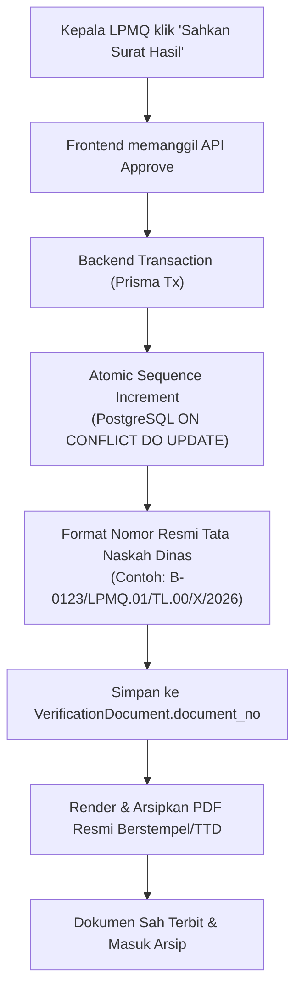

# B-03: Penomoran Surat Resmi Otomatis (Surat Hasil Verifikasi & Berita Acara)

- **ID Paket:** B-03 (Menyelesaikan Temuan UAT **U-04**)
- **Branch:** `feat/nomor-surat-otomatis`
- **Basis:** `main` (commit `d9302c2` pasca-merge B-01)
- **PIC:** Fakhri
- **Lingkup:** Backend, Database/Schema, Frontend, dan Siber (Keamanan & Konkurensi)
- **Dependensi:** B-01 (Telah selesai & di-merge ke `main`)
- **Memblokir:** B-04 (`feat/surat-lolos-dokumen-billing`), B-09 (`feat/penerbitan-surat-hasil-stt`)
- **Versi Dokumen:** 1.0 (21 Oktober 2026)

---

## 1. Latar Belakang & Masalah (Temuan UAT U-04)

Berdasarkan hasil UAT sistem per 20 Oktober 2026 (Gambar 20 pada Register Temuan UAT):
1. **Pengetikan Manual Rentan Kesalahan:**
   Pada dialog *"Sahkan Surat Hasil Verifikasi"*, pejabat/verifikator saat ini diwajibkan mengetik nomor surat hasil (`SURAT_HASIL_VERIFIKASI` / `SURAT_PEMBERITAHUAN_HASIL_VERIFIKASI`) dan nomor Berita Acara (`BERITA_ACARA_VERIFIKASI`) secara manual melalui input teks.
2. **Risiko Tabrakan & Duplikasi Nomor (*Race Condition*):**
   Validasi saat ini hanya memeriksa keunikan nomor di tabel saat data disimpan. Bila dua pejabat melakukan pengesahan dalam waktu yang berdekatan atau salah ketik, terjadi konflik 409 (*Nomor dokumen sudah digunakan*) atau inkonsistensi urutan nomor surat resmi.
3. **Format Tidak Baku & Tidak Terstandardisasi:**
   Format nomor dinas belum memiliki penyeragaman deterministik sesuai tata naskah dinas Kementerian Agama / LPMQ.
4. **Prasyarat Paket B-04 (Billing PNBP):**
   Paket B-04 mengharuskan penggabungan otomatis surat lolos verifikasi dengan kode billing SIMPONI. Dokumen surat lolos ini harus memiliki nomor surat sah yang diterbitkan secara otomatis sebelum disatukan dengan billing.

---

## 2. Sasaran & Solusi Arsitektur

B-03 mengubah alur penomoran surat verifikasi dari manual menjadi **otomatis, atomik, tidak dipakai ulang (*non-reusable*), dan formatnya dapat dikonfigurasi (*configurable pattern*)**.



### 2.1. Generator Nomor Atomik (*Atomic Sequence Counter*)
- Menggunakan tabel tersendiri `DocumentNumberSequence` di PostgreSQL dengan *composite key* `sequence_key` (kombinasi `document_type` dan `year`).
- Increment urutan (*sequence counter*) dilakukan secara transaksional dan atomik:
  ```sql
  INSERT INTO document_number_sequences (id, sequence_key, document_type, year, last_number, updated_at)
  VALUES (gen_random_uuid(), $1, $2, $3, 1, NOW())
  ON CONFLICT (sequence_key)
  DO UPDATE SET last_number = document_number_sequences.last_number + 1, updated_at = NOW()
  RETURNING last_number;
  ```
- **Aman dari *Race Condition*:** Dua *request* pengesahan yang masuk pada milidetik yang sama dijamin mendapatkan nomor berurutan yang berbeda tanpa risiko tabrakan (*collision-free*).
- **Non-Reusable (Nomor Tidak Boleh Dipakai Ulang):** Nomor yang sudah dikeluarkan tidak dapat dialokasikan kembali meskipun pengesahan dibatalkan atau dokumen direvisi.

### 2.2. Pola Format Tata Naskah Dinas (*Configurable Format*)
Format nomor surat diatur melalui konfigurasi lingkungan (`.env`) atau tabel konfigurasi dengan nilai bawaan (*default*) sesuai format tata naskah dinas LPMQ Kemenag:

| Tipe Dokumen | Default Template | Contoh Hasil | Keterangan |
| :--- | :--- | :--- | :--- |
| `SURAT_HASIL_VERIFIKASI` | `B-{seq}/LPMQ.01/TL.00/{roman_month}/{year}` | `B-0142/LPMQ.01/TL.00/X/2026` | Surat hasil lulus verifikasi |
| `SURAT_PEMBERITAHUAN_HASIL_VERIFIKASI` | `B-{seq}/LPMQ.01/TL.00/{roman_month}/{year}` | `B-0143/LPMQ.01/TL.00/X/2026` | Surat hasil belum lolos / revisi |
| `BERITA_ACARA_VERIFIKASI` | `BA-{seq}/LPMQ.01/TL.00/{roman_month}/{year}` | `BA-0089/LPMQ.01/TL.00/X/2026` | Berita Acara verifikasi naskah |

**Variabel yang didukung:**
- `{seq}`: Nomor urut berformat 4 digit dengan *leading zeros* (`0001`, `0002`, dst.). Reset tiap pergantian tahun kalender.
- `{seq_raw}`: Nomor urut tanpa *leading zeros* (`1`, `2`, dst.).
- `{year}`: Tahun 4 digit (`2026`).
- `{month}`: Bulan 2 digit (`10`).
- `{roman_month}`: Bulan angka Romawi (`I` s.d. `XII`).

### 2.3. Frontend UX (Dialog Pengesahan)
- Input pengetikan manual di dialog *"Sahkan Surat Hasil Verifikasi"* **dihilangkan dari alur wajib**.
- Dialog menampilkan informasi nomor yang akan digenerate otomatis:
  > *"Nomor surat hasil dan berita acara akan diterbitkan otomatis secara resmi oleh sistem saat disahkan."*
- Tersedia opsi *preview* nomor draf atau mode *manual override* yang **hanya dapat diakses jika pengguna memiliki wewenang khusus / flag darurat**, agar fleksibel bila ada migrasi nomor dinas manual.

---

## 3. Rencana Sesi Kerja (Urutan Pengerjaan)

| Sesi | Branch | Lingkup | Status |
| :---: | :--- | :--- | :---: |
| **Sesi 1** | `feat/nomor-surat-skema-engine` | **BE + DB:** Skema Prisma `DocumentNumberSequence`, migrasi database, dan modul mesin nomor `document-number.service.js` (generator atomik, format romawi, uji konkurensi dasar). | Siap Dikerjakan |
| **Sesi 2** | `feat/nomor-surat-integrasi-approval` | **BE:** Integrasi generator otomatis ke `verification-review.service.js`, penggantian validasi manual, pembuatan nomor pada Berita Acara & Surat Hasil, serta pengarsipan PDF berstempel nomor resmi. | Menunggu Sesi 1 |
| **Sesi 3** | `feat/nomor-surat-ui-approval` | **FE:** Modifikasi `VerificationInspectionPage.jsx`, pembersihan input nomor manual pada modal dialog, penambahan pratinjau badge nomor resmi, dan feedback sukses pengesahan. | Menunggu Sesi 2 |
| **Sesi 4** | `chore/nomor-surat-siber-concurrency` | **Siber & QA:** Uji penetrasi & beban konkurensi (10–50 approval simultan tanpa duplikasi), validasi integritas audit log, dan verifikasi dokumen PDF. | Menunggu Sesi 3 |

---

## 4. Kriteria Keberhasilan (*Definition of Done*)

1. **UAT U-04 Terselesaikan:** Pejabat penandatangan / verifikator tidak lagi mengetik nomor surat dan nomor Berita Acara secara manual pada dialog pengesahan.
2. **Keunikan & Atomisitas Terjamin:** Uji konkurensi membuktikan tidak terjadi nomor ganda atau *deadlock* saat beberapa verifikator mengesahkan dokumen secara bersamaan.
3. **Format Sesuai Standar:** Dokumen PDF resmi memuat nomor surat berformat dinas Kemenag (`B-{seq}/LPMQ.01/TL.00/{roman_month}/{year}`) secara rapi dan presisi.
4. **Semua Test Lolos:** Seluruh unit test backend, frontend vitest, dan skenario pengesahan terintegrasi lulus tanpa regresi.
5. **Siap Masuk B-04:** API verifikasi menghasilkan dokumen surat lolos bernomor resmi yang siap digabungkan dengan billing SIMPONI di paket B-04.

