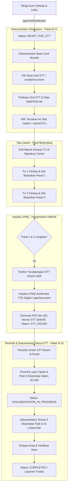

# B-18: Penetapan STT, Antarmuka Paraf TU, dan Redesain Workspace Dokumentator

- **ID Paket:** B-18 (Integrasi Terpadu B-09, B-10, dan B-11)
- **Branch:** `feat/b18-penetapan-stt-paraf-tu-dan-workspace-dokumentator`
- **Basis:** `feat/b17-integritas-siklus-revisi-dan-penutupan-kebocoran`
- **PIC:** Fakhri
- **Status:** **Spesifikasi Disusun (Siap Dikerjakan)**
- **Dependensi:** B-14 (Gerbang STT), B-15 (Rekap Kelompok), B-16 (Siklus Dumi), B-17 (Integritas Siklus Revisi)
- **Versi Dokumen:** 1.0 (8 November 2026)

---

## 1. Latar Belakang & Permasalahan

Setelah integritas siklus revisi dan penegakan wajib dumi diselesaikan pada paket B-16 dan B-17, naskah yang menyelesaikan tahap dumi cetak fisik secara sah beralih ke status `READY_FOR_STT`. Namun, alur dari `READY_FOR_STT` menuju `STT_ISSUED` hingga penyelesaian arsip (`COMPLETED`) mengalami hambatan serius dan kebuntuan fungsional (*deadlock*) di beberapa titik:

### 1.1. Kebuntuan Paraf Tata Usaha (Deadlock di UI)
- Pada backend (`official-document.service.js`), tanda tangan resmi Kepala LPMQ (`signDocument`) mewajibkan dokumen draf STT telah dikirimkan ke Tata Usaha (`SUBMITTED_TO_TU`) dan dibubuhi **Paraf 1** serta **Paraf 2** (`tuWorkflow.paraf_1` dan `tuWorkflow.paraf_2`).
- Pada frontend (`documentation.api.js`), fungsi `parafTu(documentId, order, data)` sudah didefinisikan, tetapi **sama sekali tidak pernah dipanggil di antarmuka mana pun**.
- Di `SignatureCenterPage.jsx`, dokumen STT dikunci dengan evaluasi:
  ```javascript
  const canUserSign = (isHead || currentUser?.roles?.includes('SUPERADMIN')) && !isCompleted && isSubmittedToTu;
  ```
  Karena tidak ada staf TU yang dapat membubuhkan paraf di sistem, Kepala LPMQ tidak dapat menandatangani dokumen STT. Alur penerbitan STT macet total di UI.

### 1.2. Ketiadaan Form Generator Draf STT
- Di backend, endpoint `POST /api/v1/registrations/:id/official-documents` untuk `document_type: SURAT_TANDA_TASHIH` sudah tersedia.
- Di frontend, **tidak ada tombol atau form untuk men-generate draf STT** baik di sisi Dokumentator maupun Admin Internal.
- Distributor di `SttWorkflowPanel.jsx` hanya memiliki tombol "Ajukan STT ke Admin" (`requestSttFromAdmin`). Notifikasi terkirim ke Admin, tetapi saat Admin membuka aplikasi, tidak ada antarmuka untuk membuat draf STT tersebut.

### 1.3. Antarmuka Dokumentator Belum Sesuai Mandat Paket B-11
- Halaman Dokumentator saat ini (`DokumentatorArchivePage.jsx`) hanya berupa formulir pengarsipan fisik lama (lemari, rak, kode arsip, survei mutu).
- Spesifikasi B-11 menghendaki antarmuka **Card per Mushaf** yang menampilkan seluruh riwayat dokumen tashih (Surat Permohonan, Surat Lolos Verifikasi, Berita Acara Sidang Tashih, hingga Draf/Definitif STT) dengan filter komprehensif:
  - Tahun dan Bulan pengajuan.
  - Kategori pendaftaran: Mushaf Baru, Perpanjangan STT, Mushaf Luar Negeri.
  - Standar Mushaf LPMQ: Usmani, Bahriyah, Braille, Isyarat.

### 1.4. Celah Bypass Transisi Generik ke `STT_ISSUED`
- Pada `TRANSITION_POLICY` di `registration.service.js`, transisi `READY_FOR_STT -> STT_ISSUED` belum bertanda `domainAction: true`.
- Pengguna dengan role `KEPALA_LPMQ` atau `SUPERADMIN` dapat memicu transisi status secara mentah melalui endpoint generic `POST /api/v1/registrations/:id/transition` tanpa melalui `signDocument`, sehingga nomor resmi STT tidak terbit, berkas PDF ber-QR tidak tercipta, dan rekam audit tanda tangan digital terlewati.

### 1.5. Keterputusan Kewajiban 5 Eksemplar Fisik Pasca-STT (Paket B-10)
- Komponen pelaporan oplah penerbit (`PrintingReportSection.jsx`) sudah ada di detail penerbit.
- Namun transisi status dari `STT_ISSUED -> DOCUMENTATION_IN_PROGRESS -> COMPLETED` belum terintegrasi secara otomatis saat Dokumentator menerima fisik 5 eksemplar dan mengonfirmasi verifikasi mutu cetak.

---

## 2. Arsitektur Alur Layanan Terpadu (Dumi ke Selesai)



---

## 3. Rincian Solusi & Perubahan Teknis

### Tahap 1: Backend

1. **Penutupan Celah Bypass Transisi STT:**
   - Ubah `TRANSITION_POLICY` untuk transisi `READY_FOR_STT -> STT_ISSUED` menjadi:
     ```javascript
     READY_FOR_STT: {
       STT_ISSUED: {
         allowedRoles: ['KEPALA_LPMQ', 'SUPERADMIN'],
         domainAction: true,
         description: 'Kepala LPMQ menandatangani dan menerbitkan Surat Tanda Tashih melalui pengesahan dokumen resmi',
       },
     },
     ```
   - Dengan ini, status `STT_ISSUED` hanya sah dicapai melalui pemanggilan `signDocument`.

2. **Penyempurnaan `official-document.service.js`:**
   - Pada `createDocument`:
     - Izinkan `DOKUMENTATOR`, `ADMIN_INTERNAL`, dan `SUPERADMIN` membuat draf STT jika status registrasi `READY_FOR_STT` dan PNBP terverifikasi.
     - Simpan data draf atomik dengan nomor sementara `DRAFT-STT-{YYYYMM}-{UUID}`.
   - Pada `submitToTu`:
     - Pastikan pembuat dokumen atau dokumentator dapat langsung mengarahkan draf ke antrean Tata Usaha.
   - Pada `parafDocument`:
     - Izinkan role `ADMIN_INTERNAL` dan `SUPERADMIN` bertindak sebagai Penandatangan 1 / Penandatangan 2 Tata Usaha.
     - Catat riwayat paraf secara detail di `content_snapshot.tu_workflow` (`paraf_1` dan `paraf_2`).

3. **Penyelesaian Otomatis Pasca-Dokumentasi (`documentation.service.js`):**
   - Saat Dokumentator menyimpan arsip dengan `has_received_5_exemplars: true` dan mengisi `storage_location` (lemari/rak), periksa apakah status registrasi saat ini adalah `STT_ISSUED` atau `DOCUMENTATION_IN_PROGRESS`.
   - Lakukan pemindahan status otomatis ke `COMPLETED` dan catat audit log penuntasan layanan tanda tashih.

---

### Tahap 2: Frontend

1. **Redesain Halaman Dokumentator (`/internal/documents` - `DokumentatorArchivePage.jsx`):**
   - **Tampilan Utama:** Tampilan berbasis **Card per Mushaf** (bukan sekadar formulir tunggal).
   - **Filter Cepat:**
     - Tahun & Bulan pendaftaran.
     - Standar Mushaf: *Usmani*, *Bahriyah*, *Braille*, *Isyarat*.
     - Kategori: *Mushaf Baru*, *Perpanjangan STT*, *Mushaf Luar Negeri*.
     - Status Tab: *Siap Draf STT* (`READY_FOR_STT`), *Dalam Proses Pengesahan TU/Kepala*, *STT Terbit & Menunggu 5 Eksemplar* (`STT_ISSUED`), dan *Arsip Selesai* (`COMPLETED`).
   - **Tombol Aksi Dokumen:**
     - Tombol **"Buat Draf STT"** (membuka modal konfirmasi dengan pratinjau data naskah).
     - Tombol **"Lihat Riwayat Dokumen"** (menampilkan Surat Permohonan, Surat Lolos Verifikasi, Berita Acara Tashih, dan Draf STT).
     - Tombol **"Kirim ke Tata Usaha"** (`submitToTu`).
     - Tombol **"Catat Penerimaan 5 Eksemplar & Lokasi Rak"** (membuka drawer/modal pengarsipan fisik).

2. **Antarmuka Pembubuhan Paraf Tata Usaha (`SignatureCenterPage.jsx`):**
   - Di `SignatureCenterPage.jsx`, tambahkan dukungan pembubuhan paraf untuk dokumen tipe `SURAT_TANDA_TASHIH`:
     - Jika pengguna memiliki hak paraf (role `ADMIN_INTERNAL` / `SUPERADMIN`):
       - Munculkan tombol **"Paraf 1 (Tata Usaha)"** jika Paraf 1 belum dibubuhkan.
       - Munculkan tombol **"Paraf 2 (Tata Usaha)"** jika Paraf 1 sudah selesai dan Paraf 2 belum dibubuhkan.
     - Tambahkan dialog konfirmasi paraf dengan input catatan paraf opsional.
     - Panggil `documentationApi.parafTu(documentId, order, { notes })`.

3. **Penyempurnaan Pengesahan Kepala LPMQ (`SignatureCenterPage.jsx`):**
   - Tampilkan indikator prasyarat sebelum tombol tanda tangan aktif:
     - Badge hijau: *PNBP Lunas*
     - Badge hijau: *Sidang Dumi Lolos*
     - Badge hijau: *Paraf 1 (TU) Selesai*
     - Badge hijau: *Paraf 2 (TU) Selesai*
   - Tombol **"Tandatangani STT Resmi"** aktif hanya jika seluruh prasyarat terpenuhi.
   - Dialog konfirmasi TTE Digital memuat pratinjau lembar STT resmi.
   - Panggil `documentationApi.signStt(documentId)`.

4. **Penyederhanaan Panel Distributor (`SttWorkflowPanel.jsx`):**
   - Hilangkan alur bolak-balik pengiriman draf manual antara distributor dan admin.
   - Panel ke-4 di halaman Distributor berfungsi sebagai **Tracker Status Penetapan STT**:
     - *Status: Sidang Selesai $\to$ Menunggu Draf Dokumentator $\to$ Sedang Diparaf TU $\to$ Menunggu TTD Kepala LPMQ $\to$ STT Terbit*.

5. **Antarmuka Penerbit (`PublisherOfficialDocsTab.jsx` & `PublisherDocumentList.jsx`):**
   - Tampilkan Card Ucapan Selamat & Banner Penerbitan STT Resmi saat status `STT_ISSUED`.
   - Tombol **"Unduh Surat Tanda Tashih Resmi (PDF)"** dengan ikon verifikasi QR code.
   - Kartu pengingat: **"Kewajiban Pengiriman 5 Eksemplar Fisik (Batas Waktu: 30 Hari Kalender)"** yang langsung mengarah ke `PrintingReportSection`.

---

## 4. Rencana Pengujian (Test Plan)

### Backend Tests
- `test('B18-01: Transisi READY_FOR_STT ke STT_ISSUED via generic transition ditolak (penegakan domainAction)')`
- `test('B18-02: Dokumentator dan Admin Internal berhasil membuat draf STT untuk naskah READY_FOR_STT')`
- `test('B18-03: Draf STT berhasil diteruskan ke Tata Usaha (SUBMITTED_TO_TU)')`
- `test('B18-04: Pembubuhan Paraf 1 dan Paraf 2 berhasil dicatat secara berurutan di content_snapshot')`
- `test('B18-05: Kepala LPMQ berhasil menandatangani STT dan menerbitkan PDF ber-QR resmi')`
- `test('B18-06: Verifikasi penerimaan 5 eksemplar oleh Dokumentator memindahkan status ke COMPLETED')`

### Frontend Tests (Vitest)
- `test('B18-FE-01: DokumentatorArchivePage merender daftar naskah dalam format Card per Mushaf dengan filter standar mushaf')`
- `test('B18-FE-02: Tombol Buat Draf STT memicu pembuatan dokumen dan memperbarui status card')`
- `test('B18-FE-03: SignatureCenterPage menampilkan tombol Paraf 1 dan Paraf 2 untuk role TU/Admin')`
- `test('B18-FE-04: Tombol tanda tangan Kepala LPMQ aktif saat Paraf 1 & 2 telah lengkap')`

---

## 5. Kriteria Penyelesaian (Definition of Done)

- [ ] Seluruh transisi `READY_FOR_STT -> STT_ISSUED` terkunci pada domain action `signDocument`.
- [ ] Dokumentator dapat membuat draf STT langsung dari halaman `/internal/documents`.
- [ ] Tata Usaha dapat membubuhkan Paraf 1 dan Paraf 2 di `SignatureCenterPage` tanpa error.
- [ ] Kepala LPMQ dapat menandatangani STT definitif dan menerbitkan file PDF resmi ber-QR.
- [ ] Halaman `/internal/documents` memiliki tampilan Card per Mushaf dan filter lengkap sesuai spesifikasi B-11.
- [ ] Penerbit dapat mengunduh STT resmi dan mengisi pelaporan 5 eksemplar fisik.
- [ ] Konfirmasi penerimaan 5 eksemplar fisik oleh Dokumentator berhasil menuntaskan layanan (`COMPLETED`).
- [ ] Seluruh test suite backend dan frontend lolos 100%.

